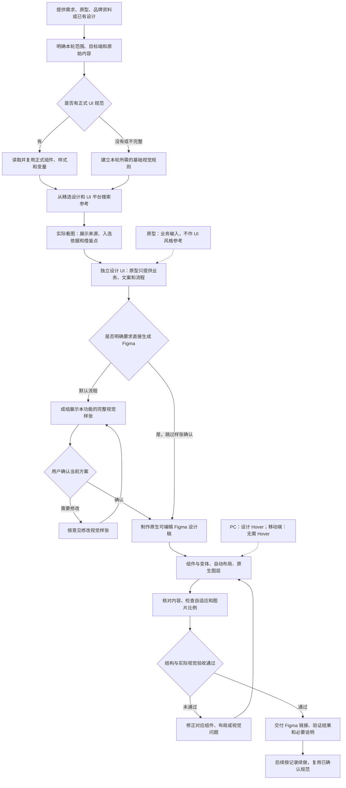

# AI → Figma 设计交付

`ai-figma-design-workflow` 是面向设计同学的 AI 设计工作流：把需求、业务原型、品牌资料或已有设计，转成可继续编辑、复用和交接的 Figma 成稿。

适用于网页、后台、移动端、桌面端和跨端产品，也适用于从零设计、已有产品新增功能、局部改版及规范修正。

[流程示意图](#流程示意图) · [完整工作流](#完整工作流) · [输入准备](#开始前准备什么) · [交付标准](#最终交付什么) · [安装与工具](#安装与工具准备) · [提示词示例](#使用示例)

## 流程示意图



默认路径是“先研究 → 独立 UI 样张 → 用户确认 → Figma 制作 → 验收交付”。明确说“直接生成 Figma”时，可以跳过样张展示与确认，研究、独立设计和验收仍需完成。

图中展示新设计的常规流程。已有确认样张落稿、同一方向续做和局部规范修正，会复用有效研究与确认记录，不从头重复。用户明确不要搜索时按其要求执行并记录；搜索受阻不等于可以自动跳过。

## 开始前准备什么

不必一次提供全部资料。先给已有内容，AI 只追问会影响结果的关键问题。

| 资料 | 作用 | 提供方式 |
| --- | --- | --- |
| 需求与任务范围 | 明确本轮要设计什么、完成哪些状态 | 文字描述、需求文档或功能清单 |
| 原型与流程 | 提取信息、文案、操作及业务关系 | 原型图、流程图或有权限的 Figma 原型链接 |
| 正式设计稿或设计系统 | 复用现有字体、配色、组件和布局规范 | 指定正式页面、组件库或真实产品界面 |
| 品牌与素材 | 保持品牌一致，使用真实图片、图标和字体 | 可使用的品牌资料及资产 |
| 目标平台与尺寸 | 决定栅格、密度、导航和适配范围 | PC、移动端、桌面端或多端；有明确尺寸时一并说明 |
| 交付位置 | 确定写入哪个 Figma 文件与页面 | 已有目标文件链接；新项目可说明需要新建 |
| 特别约束 | 避免设计超出边界 | 保留原文案、只做指定端、指定风格或必须复用的组件 |

**原型和正式 UI 稿需要区分。** 原型再像截图，也不会自动成为视觉规范；用户已标记为原型的内容，只用于业务与原始内容提取。

## 完整工作流

### 1. 理解需求，锁定本轮范围

AI 先判断当前是从零设计、已有产品扩展、改版、局部修正，还是已确认样张的落稿任务。

将资料分为业务原型、正式 UI 规范、视觉参考与品牌资产，列出本轮实际存在的文案、数据、操作与必要状态。已有 Figma 时先查看当前真实状态，避免覆盖后来改动。

默认一次围绕一个完整功能、用户任务或页面模块推进。一个功能涉及列表、详情、弹窗和结果状态时，按功能成组处理，不是一张一张孤立设计。用户授权整页或整套设计时，按该范围分批完成。

**这一阶段的结果：** 本轮范围、内容清单、平台、目标文件，以及需要解决的关键问题。不会为了补满界面自行增加业务文案、提示、入口或虚构数据。

### 2. 读取现有规范，或建立基础视觉规则

已有产品优先查看指定正式版本的组件、样式、变量与真实页面，包括字体、颜色、间距、圆角、按钮、卡片、表格、弹窗和导航。

没有现成规范时，根据产品定位、用户任务、品牌和内容密度建立本轮所需的基础视觉规则。随着功能增加再补充，不先搭一个与任务无关的大型组件库。

尺寸按实际平台确定，不统一套用手机尺寸。历史规范冲突时，以用户指定正式版本及对应业务母版为依据。用户要求完整扫描时，区分“结构索引覆盖”与“实际逐屏视觉检查”的范围。

**这一阶段的结果：** 可追溯的设计依据，以及需要新增设计的部分。

### 3. 联网研究，实际查看优秀设计参考

新视觉设计默认主动研究，不需要再输入“联网搜索”。从白名单内选择与本轮平台和用途匹配的来源，至少检索两个来源，筛选三项适用的优秀案例。

来源包括 Awwwards、Mobbin、Godly、Land-book、Refero、Behance、Pinterest、Dribbble 和站酷。平台知名不代表每件作品都合格，仍需筛选具体作品并核对来源、质量与业务适配性。

AI 必须实际查看图片、页面或截图，并在制作前展示：

- 具体作品/产品的来源链接及实际查看的图像；
- 获奖、精选、原作或成熟产品案例等可核验的入选依据；
- 排版、层级、密度、配色比例、控件呈现等具体借鉴点；
- 本轮统一的视觉方向，以及哪些地方继续遵循原有规范。

不能用随机行业网站、普通搜索图片或来源不明的转载凑数。受阻时换合适来源；仍无法完成时说明限制，不假装已经看过。

**这一阶段的结果：** 用户可查看的参考与设计方向。参考启发视觉，不改变业务，也不将第三方作品整幅照搬。

### 4. 独立设计 UI，制作完整功能样张

原型先转成文字形式的业务与内容清单。AI 再根据正式规范、品牌和参考，设计具体的信息层级、布局、排版、留白与控件表现。

不把原型截图作为风格图、图生图底图或待美化界面，也不把换色、加圆角和投影当成独立 UI 设计。

样张覆盖本轮实际需要的画面与分支。弹窗、抽屉和浮层放入对应界面，展示正确背景、蒙层、位置和遮挡；PC 的主要交互控件包含 Default / Hover 对照，移动端不要求 Hover。

默认展示样张并等待确认。用户提出修改意见时修改对应部分，不重新推翻已确定的内容。方案确认或“直接生成 Figma”的授权，只覆盖当前范围，不自动批准后续新功能。

**这一阶段的结果：** 成组的视觉样张与确认记录，或用户明确直接制作的授权。静态图片只能作为视觉样张，不能代替最终可编辑 Figma。

### 5. 制作原生可编辑的 Figma 成稿

在有样张确认或明确直接制作授权后，AI 写入目标 Figma。已有文件时沿用，组件默认集中在指定页面，不为每个功能新建组件页。

| 内容 | 制作要求 |
| --- | --- |
| 重复 UI | 先找已有组件，必要时建立精简母版；重复结构用实例复用 |
| 文字、显隐、图片差异 | 使用文字、布尔与实例替换等属性，避免重复母版 |
| 有视觉差异的状态 | 用适当变体管理，避免所有组合都建成单独变体 |
| 布局 | 使用真实自动布局、Fill / Hug / Fixed 与合理的尺寸约束 |
| 响应式 | 主内容随可用宽度延伸，等分区域合理等宽，达到最大宽度后按设计居中 |
| 四周内边距 | 逐个核对内容容器上、下、左、右 Padding 及实际留白，避免非预期贴边 |
| 图层 | 文字、控件、表格、卡片和普通图标尽量原生可编辑，清理无作用的包装画框 |
| 图片与 icon | 等比适应、等比裁切或等比缩放，避免拉宽、压扁和主体变形 |
| 配图 | 可使用透明 PNG 等图片资产，保留透明通道与清晰度 |
| PC 状态 | 可交互控件设计 Default / Hover，并可在组件实例中切换 |
| 移动端状态 | 不要求 Hover，不依赖鼠标悬停才能使用 |
| 原型交互 | 保留已有有效连接；点击、跳转、浮层和悬停触发等按需求配置 |

“画出 Hover 状态”与“预览时鼠标移入能触发 Hover”分别验收。仅设计了变体时，不声称触发交互已经完成。

**这一阶段的结果：** 可编辑的页面、组件、属性、变体、样式与自动布局结构。不会用整页图片、HTML 或脚本代替 Figma 成稿。

### 6. 做结构、自适应和实际视觉验收

AI 不仅检查图层参数，还要导出或截图，实际查看关键状态。

- **核对原始内容：** 文案、数据、提示、入口和状态与授权范围一致，无擅自添加或漏项。
- **检查组件：** 引用有效，重复 UI 正确复用，属性修改与状态切换真正生效。
- **拉宽、缩窄画框：** 对同一画框执行尺寸调整，检查较窄、基准、较宽尺寸的内容延伸、等宽分配、居中、留白与重排。
- **检查内容变化：** 临时使用长文案、内容增减和按钮显隐，确认布局不会被破坏，随后还原测试内容。
- **强制检查四边：** 逐个核对页面、卡片、弹窗、按钮等内容容器的上、下、左、右 Padding 和实际留白，在不同宽度、长文案、显隐及状态切换后复查。非预期贴边必须修正后再交付；有明确依据的通栏背景、满版图片等按设计保留。
- **检查图片与图标：** 比例正确，透明 PNG 没有白底，裁切保留必要主体。
- **对照实际视觉：** 与批准样张或正式规范对照；直接制作则按设计方向和参考借鉴点验收。
- **清理交付：** 移除测试节点、无用重复区域与冗余包装层，修复本轮造成的失效连接。

验收未通过就修正对应问题，再检查受影响部分，不用工具成功返回或格式校验通过代替视觉验收。

**这一阶段的结果：** 实际检查的范围、尺寸和结果，以及仍未解决的限制。

### 7. 交付并支持后续迭代

最终提供可直接打开的 Figma 区域链接，说明完成范围、验证结果和必要适配，必要时附最终截图。

记录本轮设计依据、参考、确认/直接制作授权、组件来源与验收结果。后续继续时先读取记录和最新 Figma，复用已经确认的规范与有效组件，不让用户重复解释已有决定。

**这一阶段的结果：** 设计同学能继续改文字、换素材、切状态、调整内容和交接的正式设计稿。

## 最终交付什么

| 交付项 | 应达到的状态 |
| --- | --- |
| Figma 页面/区域链接 | 对应当前完成范围，可打开查看 |
| 原生可编辑设计稿 | 文字、组件、矢量、图片资产和自动布局可继续维护 |
| 精简组件与必要状态 | 无无意义重复母版；PC 包含适用 Hover |
| 设计与验证说明 | 说明实际完成内容、检查范围和必要限制 |
| 项目续做记录 | 保存设计依据、确认范围和恢复任务所需信息 |

整套流程交付设计与 Figma 原型表达，不自动开发真实业务系统。跨端需求按授权范围设计；Figma 中的自适应检查也不等于已实现生产前端响应式代码。

## 安装与工具准备

使用仓库的 Skills CLI 安装入口：

```sh
npx skills add jinboamen/ui-design-skills --skill ai-figma-design-workflow
```

也可从 [v1.0.1 版本发布](https://github.com/jinboamen/ui-design-skills/releases/tag/ai-figma-design-workflow-v1.0.1) 下载 ZIP，将其中整个 `ai-figma-design-workflow/` 文件夹放入支持的客户端技能目录。入口为 [SKILL.md](SKILL.md)，两个参考文档需一并保留。版本包对应固定快照，本页为默认分支上的最新使用介绍。

该包提供流程指令，不附带 Figma 写入服务、访问凭据、字体、私有素材或其他技能。执行需要：

- 能加载本技能的 AI 客户端；
- 联网搜索及实际查看图片/页面的能力；
- 具备目标文件访问权限的 Figma 读取、写入与截图工具；
- 适用的 Figma 操作技能，例如 `figma-use`、`figma-generate-design`、`figma-generate-library`，以及新建文件时对应的能力；
- 使用 AI 位图生成时，对应的图片生成/编辑能力。

缺少能力时要说明具体限制和已完成部分，不把本地图片或脚本称为在线 Figma 成品。安装技能本身不代表这些工具已配置。

## 使用示例

### 从零设计，先确认样张

```text
使用 $ai-figma-design-workflow，根据这些需求设计 PC 产品界面。
保留提供的原始文案，先从优秀设计/UI 平台研究参考，
独立制作本功能的完整视觉样张，确认后再生成 Figma。
```

### 已有产品增加功能

```text
使用 $ai-figma-design-workflow，在已有产品中增加这个功能。
原型只作为业务和内容依据，读取我指定的正式 Figma 规范，
复用现有组件，先给我完整功能样张，确认后写入同一页面。
```

### 明确直接生成 Figma

```text
使用 $ai-figma-design-workflow，根据这些需求直接生成 Figma。
保留原始内容，先完成 UI 参考研究与独立设计，
做好精简组件、自动布局、自适应和 PC Hover，并完成实际验收。
```

### 仅做移动端

```text
使用 $ai-figma-design-workflow，只设计这个移动端功能。
按目标设备规范确定尺寸，不增加 PC 页面或 Hover。
保留原型中的内容，先给视觉样张，确认后再制作 Figma。
```

## 常见问题

**有原型，为什么还要重新设计 UI？**

原型说明功能与内容；排版、层级、留白、控件外观和品牌表现需要独立设计。正式 UI 规范有现成控件时直接复用。

**已经有设计系统，还要联网找参考吗？**

新视觉设计仍按流程研究，参考主要指导缺失或获准更新的部分，不覆盖既有正式规范。已确认方案落稿或局部修正可复用有效研究。

**能否不等样张确认，直接做 Figma？**

可以，明确说“直接生成 Figma”即可。仅跳过样张展示与确认，不跳过研究、独立设计及验收。

**能否随意补充文案，让页面更完整？**

不会擅自增加。内容缺失时在对话中说明或询问；需要 AI 写文案时应明确授权对应范围。

**有组件和自动布局，就算完成了吗？**

还要实际切换属性、调整内容和画框宽度，并看图验收。仅有图层参数不能证明最终效果正确。

## 文件说明与许可

```text
ai-figma-design-workflow/
├── SKILL.md
├── README.md
├── LICENSE
├── agents/openai.yaml
└── references/
    ├── design-research.md
    └── figma-delivery.md
```

- [SKILL.md](SKILL.md)：AI 执行入口与核心规则。
- [设计研究与原型隔离](references/design-research.md)：平台白名单、作品质量、实际看图与独立设计。
- [Figma 制作与验收](references/figma-delivery.md)：内容、组件、自适应、Hover、图片及原生图层验收。

本 Skill 及目录下文档采用 [MIT License](LICENSE)。第三方参考网站、作品、字体与素材的权利归各自权利人所有，本许可不授予这些第三方内容的使用权。

[返回技能索引](../../README.md)
